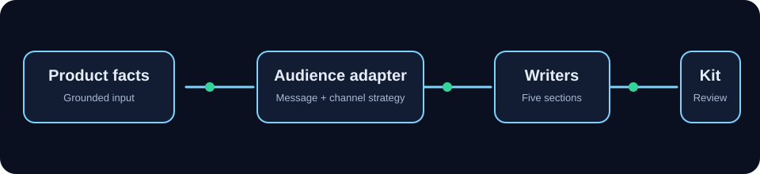

# AdForge

<p align="center">
  <strong>Grounded AI campaign generation for real product facts.</strong><br>
  Create a complete, audience-adapted advertising package in seconds.
</p>

<p align="center">
  <a href="http://127.0.0.1:8000/"></a>
  
  
  
</p>

<p align="center">
  
</p>

AdForge transforms structured product information and a selected
audience into one consistent campaign package:

**Product descriptions · Promotional copy · Social media · Visual concepts ·
Video narration**

The default provider is deterministic and offline. No API key, external image
service, or hosted model is required to run the project locally.

## Why AdForge?

- **Grounded:** generated claims are based on supplied product facts.
- **Audience-aware:** messaging changes by audience strategy, not just by
  swapping adjectives.
- **Consistent:** product name, offer, USP, tone, and CTA are carried across
  the package.
- **Practical:** preview content in the browser and export a campaign kit.
- **Private by default:** external LLM calls require explicit opt-in.

## Generated package

| Section | Included |
|---|---|
| Descriptions | One-liner, short and long copy, SEO title/meta, feature bullets |
| Promotion | Headlines, taglines, benefit/emotion/urgency variants, CTAs, email copy, Google Ads |
| Social | Instagram, Facebook, X/Twitter, LinkedIn, TikTok/Reels, 7-day calendar |
| Visuals | Art direction, palette, typography, hero concepts, poster layout, SVG previews |
| Video | 15-second, 30-second, and 60-second scene scripts plus SSML |
| Review | Quality score, consistency checks, claim-safety warnings, platform checks |

## Quick start — Windows PowerShell

Open PowerShell in the project directory:

```powershell
cd "C:\Users\thora\OneDrive\Documents\Agentic AI 2"
```

Create the virtual environment only if it does not exist:

```powershell
if (-not (Test-Path .venv\Scripts\python.exe)) {
    python -m venv .venv
}
```

Activate and install:

```powershell
.\.venv\Scripts\Activate.ps1
python -m pip install -e ".[dev,documents]"
```

Start the app:

```powershell
python -m uvicorn adforge.api:app --host 127.0.0.1 --port 8000
```

Open **<http://127.0.0.1:8000/>**. Enter a product, add three to eight
features, choose an audience, and select **Generate campaign**.

Useful URLs:

| URL | Description |
|---|---|
| <http://127.0.0.1:8000/> | AdForge browser app |
| <http://127.0.0.1:8000/docs> | Interactive Swagger API |
| <http://127.0.0.1:8000/api/health> | Health check |

Stop the server with `Ctrl+C`.

> **If the page looks outdated:** stop Uvicorn, start it again, and press
> `Ctrl+F5` in the browser.

## Try it with an example

Use these values in the browser:

```text
Product: FocusGlow Desk Lamp
Category: Lighting
Brand: BrightCo
Tone: Trustworthy
Offer: $19.99
USP: Focused light for flexible workspaces.
```

Features, one per line:

```text
Adjustable neck
Portable design
USB-C charging
Compact workspace shape
```

## API example

Save this as `request.json` while the server is running:

```json
{
  "product": {
    "name": "FocusGlow Desk Lamp",
    "category": "lighting",
    "key_features": ["adjustable neck", "portable design", "USB-C charging"],
    "price_offer": "$19.99",
    "unique_selling_point": "Focused light for flexible workspaces.",
    "brand_name": "BrightCo",
    "brand_tone": "trustworthy",
    "language": "English"
  },
  "audiences": [
    { "preset": "young_professionals" }
  ]
}
```

Generate a package:

```powershell
curl.exe -X POST http://127.0.0.1:8000/api/generate `
  -H "Content-Type: application/json" `
  --data-binary "@request.json"
```

Main endpoints:

| Method | Endpoint | Purpose |
|---|---|---|
| `GET` | `/api/health` | Service status |
| `GET` | `/api/audiences` | Audience presets |
| `POST` | `/api/generate` | Generate one or more packages |
| `POST` | `/api/generate/compare` | Compare selected audiences |
| `POST` | `/api/regenerate/{section}` | Regenerate a package section |
| `POST` | `/api/export/{format}` | Export `json`, `markdown`, `docx`, `pdf`, or `zip` |

## Development checks

```powershell
.\.venv\Scripts\Activate.ps1
python -m pytest
python -m ruff check .
python -m ruff format --check .
python -m mypy src
```

The configured minimum test coverage is **85%**.

Windows does not normally include GNU Make. Use the equivalent wrapper:

```powershell
powershell -ExecutionPolicy Bypass -File .\scripts\adforge.ps1 test
powershell -ExecutionPolicy Bypass -File .\scripts\adforge.ps1 lint
powershell -ExecutionPolicy Bypass -File .\scripts\adforge.ps1 format-check
powershell -ExecutionPolicy Bypass -File .\scripts\adforge.ps1 typecheck
```

## Optional hosted LLM

Offline mode is the default. To explicitly allow external generation:

```powershell
$env:ADFORGE_ALLOW_EXTERNAL_LLM = "true"
$env:ADFORGE_LLM_PROVIDER = "openai"
$env:ADFORGE_LLM_API_KEY = "your-api-key"
python -m uvicorn adforge.api:app --host 127.0.0.1 --port 8000
```

Set `ADFORGE_LLM_PROVIDER` to `anthropic` for Anthropic. Never commit API keys
or real customer data. Review all generated claims before publication.

## Docker

With Docker Desktop running:

```powershell
docker compose up --build
```

Open <http://127.0.0.1:8000/> and stop with:

```powershell
docker compose down
```

## Project structure

```text
src/adforge/
├── api.py                 # FastAPI app and routes
├── models.py              # Typed request and AdPackage contracts
├── audiences/             # Presets and audience adaptation
├── generation/            # Offline and hosted providers
├── checks/                # Claims, consistency, platform, quality checks
├── exporters/             # JSON, Markdown, DOCX, PDF, ZIP
├── visuals/               # SVG previews and ImageProvider interface
└── static/                # Browser campaign wizard
```

## Responsible use

AdForge outputs are drafts, not legal or marketing approval. Verify every
claim, price, offer, visual, disclosure, and platform-specific asset. Follow
applicable advertising law and platform policies. Product fields are treated as
untrusted data and external LLM use is opt-in.

See [docs/COMPLIANCE.md](docs/COMPLIANCE.md),
[docs/ARCHITECTURE.md](docs/ARCHITECTURE.md), and
[docs/DECISIONS.md](docs/DECISIONS.md).

## License

AdForge is released under the [MIT License](LICENSE).
